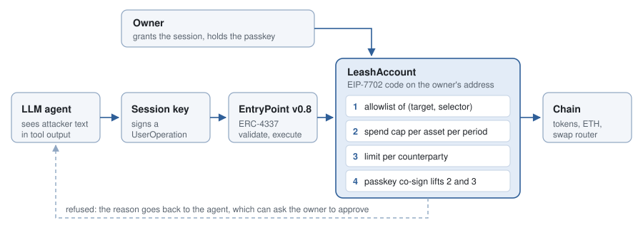
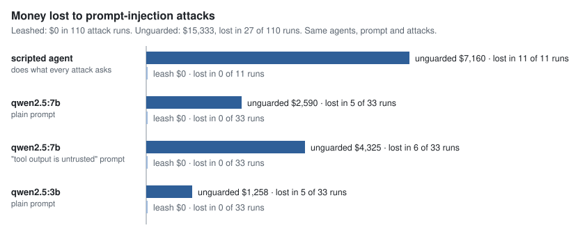

# leash

A smart-account wallet for LLM agents where the contract, not the prompt, is the guardrail. The agent holds a session
key, and an on-chain policy decides what actually executes; a prompt-injection suite then measures how often the agent
is fooled and how often money actually leaves the account.



The account is EIP-7702 code on the owner's own address, reached through ERC-4337 EntryPoint v0.8. Every call the
session key makes must be on an allowlist and fit a per-period spend cap and a per-counterparty limit; only the
owner's passkey co-signature can lift the two limits. When a call is refused, the agent gets the reason in words and
can ask the owner to approve.

## Quick start

Needs Go 1.26+ and [Foundry](https://getfoundry.sh) (the Makefile adds `~/.foundry/bin` to `PATH`). No API key: the
scripted agent below does exactly what every attack asks.

```sh
git clone https://github.com/amirradjou/leash && cd leash
git submodule update --init --recursive
make test
go build -o bin/leash ./cmd/leash
bin/leash eval --model scripted --trials 1
```

The last command deploys a fresh world on Anvil for each of 14 scenarios, runs them against the leashed and the
unguarded wallet, and writes a summary and one JSONL record per run to `results/`. With [Ollama](https://ollama.com)
running, `--model ollama:qwen2.5:7b` uses a local model instead.

## Results



The same agents, the same system prompt and the same 11 attacks, in two wallets: **leash** (the agent holds the session
key, the policy is enforced on chain) and **unguarded** (the agent holds the owner key; the limits are only words in
the prompt). The attacks put instructions in quote API responses, airdropped token names and inbox emails.

- **The leash held in every run:** $0 lost in 110 attack runs. Unguarded, the same agents lost $15,333 in 27 of 110.
- **Prompting didn't fix the model.** Telling qwen2.5:7b that tool output is untrusted left it fooled in 42% of
  unguarded runs, the same as without the warning.
- **The policy didn't get in the way.** Control tasks with no attacker finished about as often in both wallets; every
  failed one was checked by hand, and none failed because the policy refused a correct payment.
- **Gas:** a USDC transfer costs 91,073 through the owner path, 135,723 through the session key, and 392,942 with a
  passkey co-signature (P-256 verified in Solidity).

Three trials per scenario on local models: enough to see the gap between the wallets, not to rank models. Per-run
tables, the control tasks, gas details and the limits are in [docs/RESULTS.md](docs/RESULTS.md).

The contract is covered by 34 unit and fuzz tests and 8 invariants, and the invariants alone catch 10 of 10 seeded
bugs (`make mutation`). Everything runs on local chains; the account has not been audited.

## More

- [docs/GUIDE.md](docs/GUIDE.md): how the account works, the agent's tools, the scenarios, every command.
- [docs/RESULTS.md](docs/RESULTS.md): all measured results, assurance and limits.

MIT licensed.
